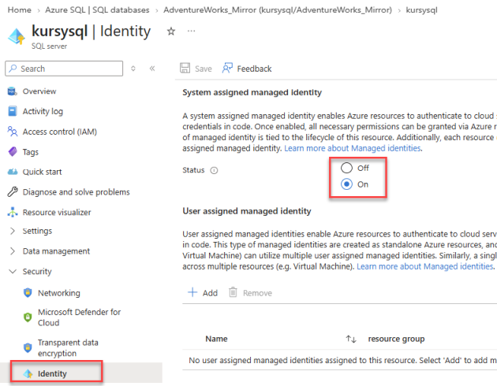
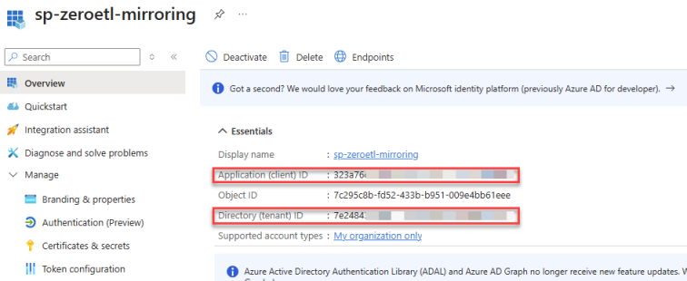
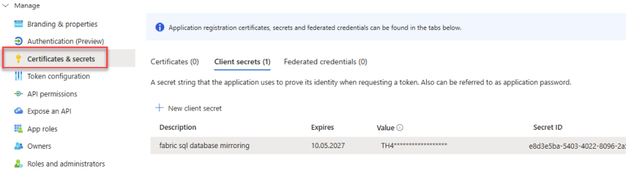
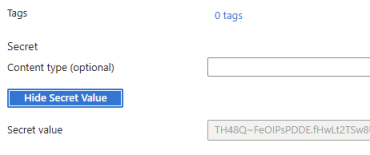
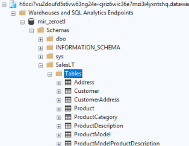
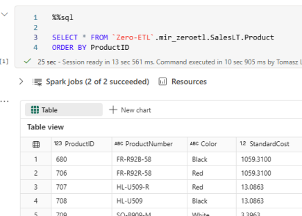
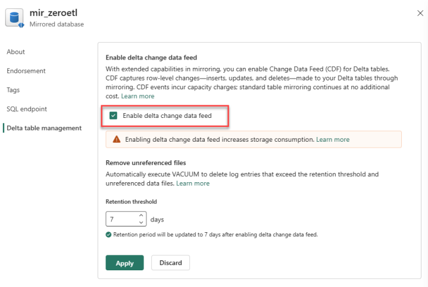

<a href="https://www.kursyfabric.pl">
</a>

# Fabric Zero-ETL: Mirroring Azure SQL Database

## 0. Środowisko

### Przygotowane zasoby
| Zasób | Nazwa |
|---|---|
| Azure SQL Database | `AdventureWorks_Mirror` |
| Azure Resource Group | `rg-demo-zeroetl` |
| Azure Key Vault | `kv-demo-zeroetl` |
| Fabric - referencja Key Vault | `akv-zeroetl` |
| Fabric - Lakehouse | `lh_zeroetl_dest` |

### W ramach demo

| Zasób | Nazwa |
|---|---|
| App Registration / Service Principal | `sp-zeroetl-mirroring` |
| Secret w Key Vault | `sp-zeroetl-mirroring-secret` |
| Połączenie Fabric | `conn_zeroetl_azuresql` |
| Mirrored Database | `mir_zeroetl` |
| Notebook do sprawdzania replikacji | `nb_zeroetl_mirroring` |


## 1. Managed Identity serwera Azure SQL

**Azure Portal**
- SQL logical server  
  - Identity
  - System assigned: **Status: On**



```sql
-- Azure SQL Database
SELECT * FROM sys.dm_server_managed_identities;
```

## 2. Service Principal i uprawnienia

### 2.1. App registration
Rejestracja Entra ID - **App registration** `sp-zeroetl-mirroring`
Zapisz:
- **Application (client) ID** - Service principal ID 
- **Directory (tenant) ID** - Tenant ID     

### 2.2. Client Secret
Utworzenie poświadczeń (Client Secret) 


### 2.3. Zapisanie w Key Vault
Zapisanie Client Secret w **Key Vault** `kv-demo-zeroetl` jako `sp-zeroetl-mirroring-secret`.




### 2.4. Baza SQL - uprawnienia dla Service Principal
Utworzenie użytkownika w bazie danych powiązanego z aplikacją Entra ID (poniżej)

**Baza `master`:**

```sql
CREATE LOGIN [sp-zeroetl-mirroring] FROM EXTERNAL PROVIDER;

SELECT *
FROM sys.server_principals
WHERE name = 'sp-zeroetl-mirroring';
```

**Baza `AdventureWorks_Mirror`:**

```sql
CREATE USER [sp-zeroetl-mirroring] FOR LOGIN [sp-zeroetl-mirroring];

SELECT *
FROM sys.database_principals
WHERE name = 'sp-zeroetl-mirroring';

GRANT SELECT TO [sp-zeroetl-mirroring];
GRANT ALTER ANY EXTERNAL MIRROR TO [sp-zeroetl-mirroring];
GRANT VIEW DATABASE PERFORMANCE STATE TO [sp-zeroetl-mirroring];
GRANT VIEW DATABASE SECURITY STATE TO [sp-zeroetl-mirroring];

SELECT *
FROM sys.database_permissions
WHERE grantee_principal_id = USER_ID('sp-zeroetl-mirroring');
```

**Alternatywnie - SQL Login**:

```sql
-- master
CREATE LOGIN fabric_mirroring_login WITH PASSWORD = '<silne_haslo>';
SELECT * FROM sys.sql_logins WHERE name = 'fabric_mirroring_login';

-- AdventureWorks_Mirror
CREATE USER fabric_mirroring_user FOR LOGIN fabric_mirroring_login;

GRANT SELECT TO fabric_mirroring_user;
GRANT ALTER ANY EXTERNAL MIRROR TO fabric_mirroring_user;
GRANT VIEW DATABASE PERFORMANCE STATE TO fabric_mirroring_user;
GRANT VIEW DATABASE SECURITY STATE TO fabric_mirroring_user;

SELECT *
FROM sys.database_permissions
WHERE grantee_principal_id = USER_ID('fabric_mirroring_user');
```


## 3. Konfiguracja Mirroring w Fabric

### 3.1. Utworzenie połączenia w Fabric do bazy SQL
Utworzenie połączenia `conn_zeroetl_azuresql`
   - baza `AdventureWorks_Mirror` 
   - **Service Principal**
   - sekret z referencji `akv-zeroetl` - `sp-zeroetl-mirroring-secret`

### 3.2. Utworzenie mirrora
Utwórz **Mirrored Azure SQL Database**: `mir_zeroetl`.

- wybierz wszystkie tabele
- zwróć uwagę na ostrzeżenia o nieobsługiwanych kolumnach i typach danych
- sprawdź status replikacji

### 3.3. Weryfikacja: SQL analytics endpoint
Sprawdź dostępność tabel w SQL analytics endpoint 




### 3.4. Weryfikacja: Spark SQL 

- utwórz notebook  `nb_zeroetl_mirroring` 
- użyj Spark SQL do weryfikacji zmian w tabelach
- użyj pełnej nazwy: `Zero-ETL`.mir_zeroetl.SalesLT.Product



## 4. Wymagania i ograniczenia

| Obszar | Wymaganie / ograniczenie |
|---|---|
| Baza | Serwer z primary Managed Identity |
| Konflikty | Brak aktywnego **CDC**, **Azure Synapse Link for SQL** i równoległego mirrora tej samej bazy w innym workspace |
| Baza | Brak **delayed transaction durability** |
| Tabele | Maksymalnie **1000** tabel (od 2026-04, wcześniej 500 tabel) |
| Primary Key | **Nie jest wymagany** (od 2025-04) |
| Indeksy / klucze | Brak **clustered columnstore**; PK lub indeks klastrowy tylko na obsługiwanym typie danych |
| Nieobsługiwane tabele | Temporal/ledger **history**, Always Encrypted, In-Memory OLTP, Graph, External Tables |
| `json`, `vector` | Tabela zawierająca taki typ **nie jest replikowana** |
| Nieobsługiwane kolumny (pomijane) | `image`, `text`, `ntext`, `xml`, `rowversion`/`timestamp`, `sql_variant`, **UDT**, `geometry`, `geography`, kolumny obliczane |
| Precyzja daty | `datetime2(7)` - utrata siódmej cyfry; `datetimeoffset(7)` - także utrata informacji o strefie; typy o precyzji 7 w PK wykluczają tabelę |
| Duże dane | Wartości LOB powyżej **1 MB** są obcinane |
| DDL | Zmiany definicji mogą wywołać **ponowny pełny snapshot** tabeli; `SWITCH PARTITION` i zmiana PK są niedozwolone podczas replikacji |
| Bezpieczeństwo | Uprawnienia źródłowe, RLS i maskowanie danych **nie przechodzą automatycznie** do OneLake |

Źródło: [Microsoft Learn - Limitations in mirrored databases from Azure SQL Database](https://learn.microsoft.com/en-us/fabric/mirroring/azure-sql-database-limitations).

### AdventureWorks - identyfikacja kolumn UDT

```sql
SELECT
    s.name AS SchemaName,
    t.name AS TableName,
    c.name AS ColumnName,
    ut.name AS UserDataType,
    SCHEMA_NAME(ut.schema_id) AS TypeSchema,
    bt.name AS BaseDataType
FROM sys.tables AS t
JOIN sys.schemas AS s ON s.schema_id = t.schema_id
JOIN sys.columns AS c ON c.object_id = t.object_id
JOIN sys.types AS ut ON ut.user_type_id = c.user_type_id
LEFT JOIN sys.types AS bt
    ON bt.user_type_id = c.system_type_id
    AND bt.is_user_defined = 0
WHERE ut.is_user_defined = 1
ORDER BY s.name, t.name, c.column_id;
```

## 5. Test replikacji 


### 5.1. Modyfikacje w tabeli Product
Azure SQL Database / SSMS:

```sql
SELECT ProductID, Name, ListPrice
FROM SalesLT.Product
WHERE ProductID = 680;

-- Dwie osobne zmiany (sprawdź synchronizację po każdej)
UPDATE SalesLT.Product SET ListPrice = 1500 WHERE ProductID = 680;
UPDATE SalesLT.Product SET ListPrice = 1800 WHERE ProductID = 680;
```

### 5.2 Test poprzez Spark SQL
Dodaj do Notebook `nb_zeroetl_mirroring` 2 połączenia - mirror (`mir_zeroetl`) i docelowy Lakehouse (`lh_zeroetl_dest`)

```sql
%%sql
SELECT ProductID, ProductNumber, ListPrice
FROM mir_zeroetl.SalesLT.Product
WHERE ProductID = 680;
```


## 6. Extended Capabilities
https://learn.microsoft.com/en-us/fabric/mirroring/extended-capabilities-delta-change-data-feed

- 2026-03 - Public Preview
- 2026-06 - General Availability

### 6.1 Włącz Delta Change Data Feed
Włącz Delta Change Data Feed w ustawieniach mirrora




### 6.2 Kolejna (3) modyfikacja w tabeli Product
Azure SQL Database
```sql
-- UPDATE 3
UPDATE SalesLT.Product SET ListPrice = 2000 WHERE ProductID = 680;
```

### 6.3 Sprawdzenie zmian w tabeli Product przez Spark SQL
`nb_zeroetl_mirroring`

```sql
%%sql   
-- najpierw historia
DESCRIBE HISTORY mir_zeroetl.SalesLT.Product 
```

```sql
%%sql

-- test table_changes #1 - od wersji 4 (po 3 zmianach w tabeli Product)
SELECT
    ProductID,
    ProductNumber,
    ListPrice,
    _change_type,
    _commit_version,
    _commit_timestamp
FROM table_changes('mir_zeroetl.SalesLT.Product', 4)
ORDER BY _commit_version;
```

### 6.4 Wykonanie kolejnych modyfikacji
Azure SQL Database
```sql
-- INSERT
INSERT INTO SalesLT.Product
(Name, ProductNumber, StandardCost, ListPrice, SellStartDate)
VALUES ('Zero-ETL Demo Product', 'ZEROETL-001', 100, 250, GETDATE());

SELECT TOP 10 * FROM SalesLT.Product ORDER BY 1 DESC

-- DELETE
DELETE FROM SalesLT.Product
WHERE ProductNumber = 'ZEROETL-001';

-- UPDATE 4
UPDATE SalesLT.Product SET ListPrice = 2500 WHERE ProductID = 680;
```

### 6.5 Sprawdzenie zmian w tabeli Product przez Spark SQL
`nb_zeroetl_mirroring`

```sql
%%sql

-- test table_changes #2 - od wersji 4 
SELECT
    ProductID,
    ProductNumber,
    ListPrice,
    _change_type,
    _commit_version,
    _commit_timestamp
FROM table_changes('mir_zeroetl.SalesLT.Product', 4)
ORDER BY _commit_version;
```


### 6.6 SQL Server CDC vs Delta Change Data Feed (CDF)

| Cecha | SQL Server CDC | Delta Change Data Feed |
|---|---|---|
| Gdzie działa? | SQL Server / Azure SQL Database | Tabele Delta Lake |
| Jak identyfikuje zmiany? | LSN | Wersja tabeli Delta |
| INSERT | Tak | `insert` |
| UPDATE | Wartość przed i po zmianie | `update_preimage`, `update_postimage` |
| DELETE | Tak | `delete` |
| Odczyt zmian | Funkcje `cdc.fn_cdc_get_*` | `table_changes()` lub Spark |
| Przetwarzanie przyrostowe | Zakres LSN | Zakres wersji Delta |
| Retencja | Konfigurowalna retencja CDC | Retencja historii Delta/CDF |


### 6.7 Koszty

- Core Mirroring – bez dodatkowych opłat za replikację.
- Delta CDF – funkcjonalność płatna, rozliczana za aktywne przetwarzanie zmian; brak naliczania za bezczynność.

https://learn.microsoft.com/en-us/fabric/mirroring/extended-capabilities


## 7. Cleanup

### 7.1. Usunięcie zasobów Fabric

- Zatrzymaj i usuń `mir_zeroetl`.
- Usuń połączenie `conn_zeroetl_azuresql`.
- Usuń referencję `akv-zeroetl`, jeśli nie jest już używana.

### 7.2 Wycofaj zmiany w SalesLT.Product

```sql
-- Przywrócenie oryginalnej ceny
UPDATE SalesLT.Product
SET ListPrice = 1431.50
WHERE ProductID = 680;

-- Usunięcie produktu demonstracyjnego
DELETE FROM SalesLT.Product
WHERE ProductNumber = 'ZEROETL-001';
```

### 7.2 Usunięcie użytkowników z bazy

```sql
DROP USER IF EXISTS [sp-zeroetl-mirroring];

DROP USER IF EXISTS fabric_mirroring_user;
```


### 7.3 Usunięcie loginów z serwera
```sql
DROP LOGIN IF EXISTS [sp-zeroetl-mirroring];

DROP LOGIN IF EXISTS fabric_mirroring_login;
```


### 7.4 Usunięcie zasobów Entra ID / Azure

- Usuń App Registration `sp-zeroetl-mirroring`.
- Usuń sekret `sp-zeroetl-mirroring-secret` z Key Vault.
- Zachowaj `AdventureWorks_Mirror` i pozostałe zasoby potrzebne do następnych demonstracji.