<a href="https://www.kursyfabric.pl"> </a>

# Fabric Zero-ETL: Copy Job

## 0. Środowisko

### Przygotowane zasoby

| Zasób                         | Nazwa                |
| ----------------------------- | -------------------- |
| Azure SQL Database            | `AdventureWorks_CDC` |
| Azure Resource Group          | `rg-demo-zeroetl`    |
| Azure Key Vault               | `kv-demo-zeroetl`    |
| Fabric - referencja Key Vault | `akv-zeroetl`        |
| Fabric - Lakehouse            | `lh_zeroetl_dest`    |

### W ramach demo

| Zasób                                | Nazwa                       |
| ------------------------------------ | --------------------------- |
| App Registration / Service Principal | `sp-zeroetl-copyjob`        |
| Sekret w Key Vault                   | `sp-zeroetl-copyjob-secret` |
| Połączenie Fabric do Azure SQL       | `conn_zeroetl_azuresql_cdc` |
| Copy Job - Watermark                 | `cj_zeroetl_watermark`      |
| Copy Job - CDC + Merge               | `cj_zeroetl_cdc`            |
| Copy Job - CDC + SCD2                | `cj_zeroetl_cdc2`           |
| Notebook do weryfikacji              | `nb_zeroetl_copyjob`        |

### Weryfikacja - Azure SQL Database / SSMS

Połącz się z **konkretną bazą `AdventureWorks_CDC`** (w Azure SQL Database nie przełączamy bazy przez `USE`):

```
SELECT DB_NAME() AS CurrentDatabase;

SELECT COUNT(*) AS SalesOrderHeaderRows FROM SalesLT.SalesOrderHeader;
SELECT COUNT(*) AS ProductRows FROM SalesLT.Product;

SELECT TOP (5) SalesOrderID, CustomerID, ModifiedDate
FROM SalesLT.SalesOrderHeader
ORDER BY SalesOrderID DESC;

SELECT TOP (5) ProductID, ProductNumber, ListPrice
FROM SalesLT.Product
ORDER BY ProductID DESC;
```

## 1. Połączenie Fabric do Azure SQL Database

### 1.1 Service principal 

Rejestracja Entra ID - **App registration** `sp-zeroetl-copyjob`
- **Application (client) ID** - Service principal ID 
- **Directory (tenant) ID** - Tenant ID     
### 1.2 Client Secret
Utworzenie poświadczeń
### 1.3 Zapisanie w Key Vault
Zapisanie Client Secret w **Key Vault** `kv-demo-zeroetl` jako `sp-zeroetl-copyjob-secret`.
### 1.4 Baza SQL - uprawnienia dla Service Principal
Utworzenie użytkownika w bazie danych  Azure SQL `AdventureWorks_CDC` powiązanego z aplikacją Entra ID

Baza `master`:

```sql
CREATE LOGIN [sp-zeroetl-copyjob] FROM EXTERNAL PROVIDER;

SELECT *FROM sys.server_principals WHERE name = 'sp-zeroetl-copyjob';
```

**Baza `AdventureWorks_CDC`:**

```sql
CREATE USER [sp-zeroetl-copyjob] FOR LOGIN [sp-zeroetl-copyjob];

SELECT * FROM sys.database_principals WHERE name = 'sp-zeroetl-copyjob';

GRANT SELECT TO [sp-zeroetl-copyjob];

SELECT * FROM sys.database_permissions WHERE grantee_principal_id = USER_ID('sp-zeroetl-copyjob');
```

## 2. Utworzenie połączenia w Fabric do bazy SQL
Utworzenie połączenia `conn_zeroetl_azuresql_cdc`
   - baza `AdventureWorks_CDC` 
   - **Service Principal**
   - sekret z referencji `akv-zeroetl` - `sp-zeroetl-copyjob-secret`


## 3. Copy Job #1 - Watermark + Merge

### 3.1. Konfiguracja Copy Job

- New item:`cj_zeroetl_watermark`
- Source: **Azure SQL Database**, połączenie: `conn_zeroetl_azuresql_cdc`
- tabele: 
   - SalesLT.SalesOrderHeader
   - SalesLT.SalesOrderDetail
- Destination: **Lakehouse**, `lh_zeroetl_dest`
- Settings: 
  - Read method: **Incremental copy**
  - Write method: **Merge**
    - Key columns for merge: PK
  - Incremental column: **`ModifiedDate`**.

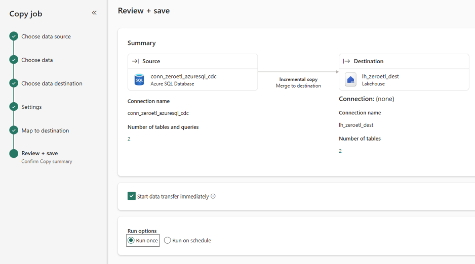


### 3.2. Pierwsze uruchomienie - Full Load

1. Poczekaj na zakończenie inicjalnego uruchomienia `cj_zeroetl_watermark` 
    uruchomienie **Incremental copy** kopiuje komplet danych. Kolejne odczyty ograniczają się do rekordów z `ModifiedDate` większym niż zapisany watermark
    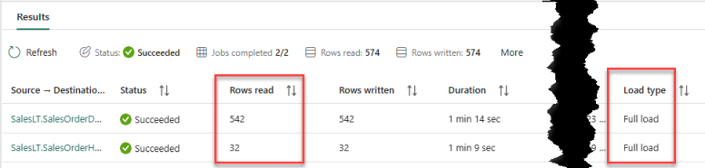
2. Sprawdź liczbę rekordów po stronie Lakehouse
	- lh_zeroetl_dest - lakehouse
	- nb_zeroetl_copyjob
	- lh_zeroetl_dest - sql analytics endpoint

### 3.3. Kolejne uruchomienie bez zmian
Uruchom `cj_zeroetl_watermark` 
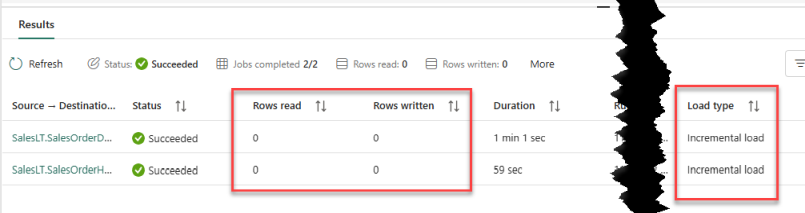


### 3.4. Uruchomienie po zmianach w tabeli

1. Wstaw 3 wiersze **SalesLT.SalesOrderHeader** oraz zmodyfikuj jeden z nich
```sql
	DECLARE @CustomerID int = (SELECT TOP 1 CustomerID FROM SalesLT.Customer ORDER BY CustomerID);
	
	INSERT INTO SalesLT.SalesOrderHeader
	(
	    RevisionNumber,  OrderDate,  DueDate,  ShipDate,  Status,  OnlineOrderFlag,  PurchaseOrderNumber,
	    AccountNumber,  CustomerID,  ShipMethod,  CreditCardApprovalCode,  SubTotal,  TaxAmt,  Freight,
	    Comment,  rowguid,  ModifiedDate
	)
	VALUES
	(1, GETDATE(), DATEADD(DAY, 7, GETDATE()), DATEADD(DAY, 2, GETDATE()),
	 5, 1, 'PO-ZEROETL-001', '10-4020-000000', @CustomerID, 'CARGO TRANSPORT 5', 'APPROVED',
	 1000.00, 80.00, 50.00, 'Test order 1', NEWID(), GETDATE()),
	
	(1, GETDATE(), DATEADD(DAY, 10, GETDATE()), DATEADD(DAY, 3, GETDATE()),
	 5, 1, 'PO-ZEROETL-002', '10-4020-000001', @CustomerID, 'CARGO TRANSPORT 5', 'APPROVED',
	 2500.00, 200.00, 100.00, 'Test order 2', NEWID(), GETDATE()),
	
	(1, GETDATE(), DATEADD(DAY, 14, GETDATE()), DATEADD(DAY, 4, GETDATE()),
	 5, 1, 'PO-ZEROETL-003', '10-4020-000002', @CustomerID, 'CARGO TRANSPORT 5', 'APPROVED',
	 500.00, 40.00, 25.00, 'Test order 3', NEWID(), GETDATE());
	
	-- Modyfikacja jednego z wstawionych zamówień
	UPDATE SalesLT.SalesOrderHeader
	SET
	    Comment = N'Zero-ETL Watermark - UPDATE',
	    Freight = 25.00,
	    ModifiedDate = GETUTCDATE()
	WHERE PurchaseOrderNumber = N'PO-ZEROETL-001';
```
1. Uruchom `cj_zeroetl_watermark`
    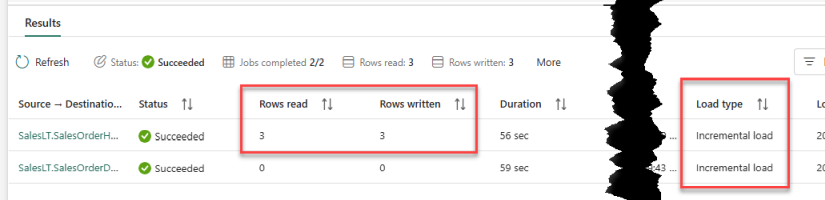
2. Sprawdź czy wiersze zostały wstawione/ zmodyfikowane
	- nb_zerotl_copyjob
	- lh_zeroetl_dest - sql analytics endpoint
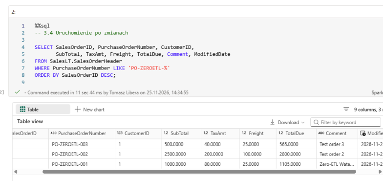


### 3.5. Uruchomienie po skasowaniu wiersza

1. Skasuj wiersz PurchaseOrderNumber = N'PO-ZEROETL-001'
```sql
	DELETE FROM SalesLT.SalesOrderHeader 
	WHERE PurchaseOrderNumber = N'PO-ZEROETL-001';
```
1. Uruchom `cj_zeroetl_watermark`
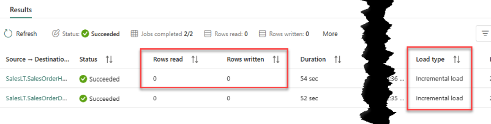
2. Sprawdź, że wiersz **nie został** skasowany
    - nb_zerotl_copyjob
    - h_zeroetl_dest - sql analytics endpoint
3. **Efekt:** rekord nie istnieje już w Azure SQL Database, ale pozostaje w Lakehouse. Watermark nie przenosi informacji o usunięciu.


## 4. Copy Job #2 CDC + Merge (SCD Type 1)

### 4.1. Konfiguracja CDC w bazie źródłowej
Włącz CDC w bazie AdventureWorks_CDC. Azure SQL Database używa własnego schedulera CDC - **nie wymaga SQL Server Agent**.
```sql
IF (SELECT is_cdc_enabled FROM sys.databases WHERE database_id = DB_ID()) = 0
    EXEC sys.sp_cdc_enable_db;

IF NOT EXISTS(SELECT * FROM cdc.change_tables WHERE source_object_id = OBJECT_ID(N'SalesLT.Product'))
	EXEC sys.sp_cdc_enable_table
		@source_schema = N'SalesLT',
		@source_name = N'Product',
		@role_name = NULL,
		@supports_net_changes = 1;

SELECT
    capture_instance,
    supports_net_changes,
    start_lsn
FROM cdc.change_tables
WHERE source_object_id = OBJECT_ID(N'SalesLT.Product');
```

### 4.2. Konfiguracja Copy Job

- New item:`cj_zeroetl_cdc`
- Source: **Azure SQL Database**, połączenie: `conn_zeroetl_azuresql_cdc`
- tabele: 
   - SalesLT.Product
- Destination: **Lakehouse**, `lh_zeroetl_dest`
- Settings: 
  - Read method: **Incremental copy/ CDC**
  - Write method: **Merge (SCD1)**
    - Key columns for merge: **ProductID**

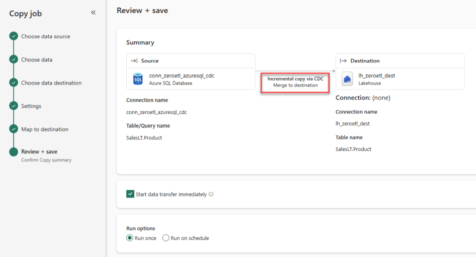
### 4.3. Pierwsze uruchomienie - Full Load

Poczekaj na zakończenie inicjalngo uruchomienia `cj_zeroetl_cdc` 
Sprawdź tabelę docelową w nb_zerotl_copyjob

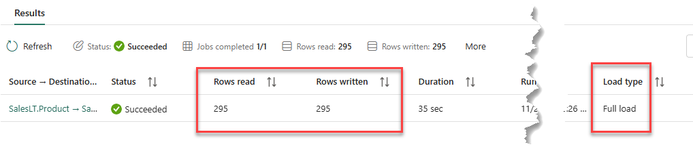

### 4.4. Kolejne uruchomienie bez zmian

Uruchom `cj_zeroetl_cdc` 

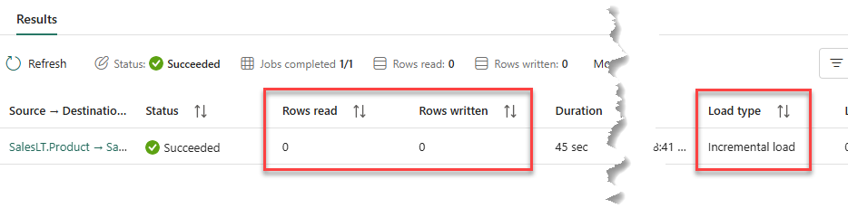
### 4.5. Uruchomienie po zmianach w tabeli

1. Wstaw 3 wiersze **SalesLT.Product** oraz zmodyfikuj jeden z nich
```sql
	INSERT INTO SalesLT.Product
	(Name, ProductNumber, StandardCost, ListPrice, SellStartDate, ModifiedDate)
	VALUES 
		(N'Zero-ETL CDC Merge1', N'ZEROETL-CJ-MERGE1', 100.00, 150.00, GETUTCDATE(), GETUTCDATE()),
		(N'Zero-ETL CDC Merge2', N'ZEROETL-CJ-MERGE2', 200.00, 250.00, GETUTCDATE(), GETUTCDATE()),
		(N'Zero-ETL CDC Merge3', N'ZEROETL-CJ-MERGE3', 300.00, 350.00, GETUTCDATE(), GETUTCDATE());
	
	SELECT ProductID, ProductNumber, Name, ListPrice
	FROM SalesLT.Product WHERE ProductNumber LIKE N'ZEROETL-CJ-MERGE%';
	
	UPDATE SalesLT.Product
	SET ListPrice = 275.00, ModifiedDate = GETUTCDATE() 
	WHERE ProductNumber = N'ZEROETL-CJ-MERGE1';
```
1. Uruchom `cj_zeroetl_cdc`
    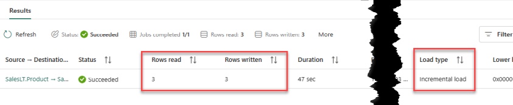
2. Sprawdź czy wiersze zostały wstawione/ zmodyfikowane
	- nb_zerotl_copyjob
	- lh_zeroetl_dest - sql analytics endpoint

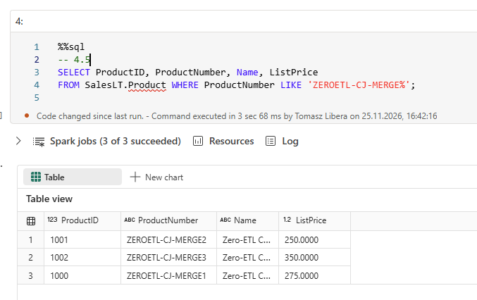
### 4.6. Uruchomienie po skasowaniu wiersza

1. Skasuj wiersz ProductNumber = N'ZEROETL-CJ-MERGE2'
```sql
   DELETE FROM SalesLT.Product
   WHERE ProductNumber = N'ZEROETL-CJ-MERGE2';
```
2. Uruchom `cj_zeroetl_cdc`

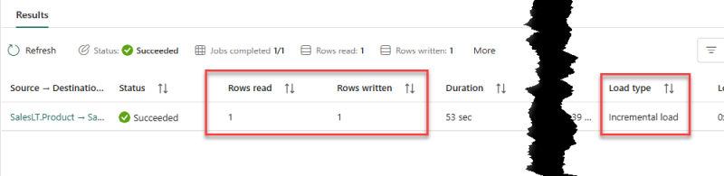

3. Sprawdź, że wiersz **został** skasowany
    - nb_zerotl_copyjob
    - h_zeroetl_dest - sql analytics endpoint
4. **Efekt:** rekord został skasowany z Lakehouse.
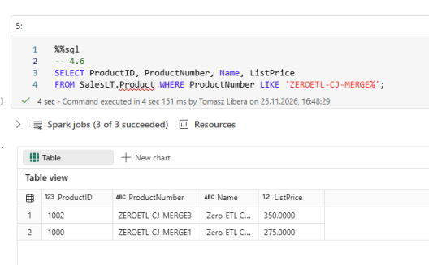


## 5. Copy Job #3 - CDC + Merge (SCD Type 2)

### 5.1. Konfiguracja Copy Job

- New item:`cj_zeroetl_cdc2`
- Source: **Azure SQL Database**, połączenie: `conn_zeroetl_azuresql_cdc`
- tabele: 
   - SalesLT.Product
- Destination: 
	- **Lakehouse**, `lh_zeroetl_dest`
	- tabela SalesLT.Product_scd2
- Settings: 
  - Read method: **Incremental copy/ CDC**
  - Write method: **Merge (SCD2)**
    - Key columns for merge: **ProductID**

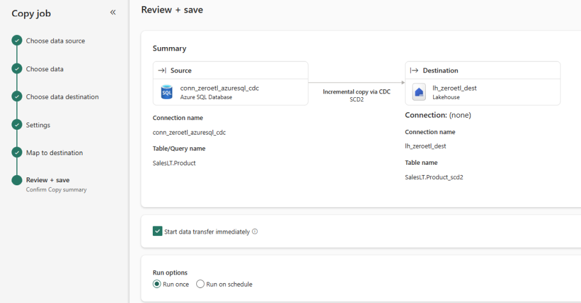


### 5.2. Pierwsze uruchomienie 

Poczekaj na zakończenie inicjalngo uruchomienia `cj_zeroetl_cdc2` 


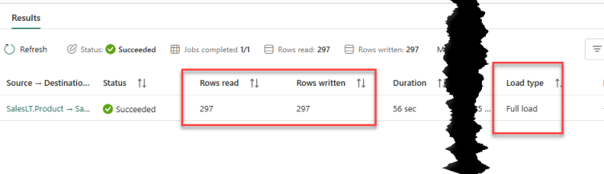
Sprawdź tabelę docelową **SalesLT.Product_scd2** w `nb_zerotl_copyjob`
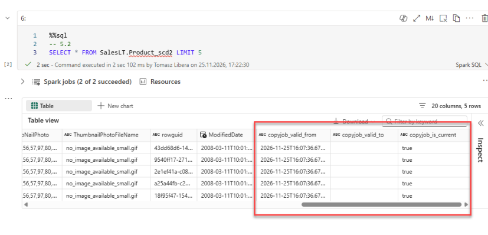

### 5.3. Wstawienie nowych wierszy do tabeli źródłowej

Wstaw wiersze do tabeli
```sql
INSERT INTO SalesLT.Product
(Name, ProductNumber, StandardCost, ListPrice, SellStartDate, ModifiedDate)
VALUES 
	(N'Zero-ETL CDC SCD2_1', N'ZEROETL-CJ-SCD2_1', 100.00, 100.00, GETUTCDATE(), GETUTCDATE()),
	(N'Zero-ETL CDC SCD2_2', N'ZEROETL-CJ-SCD2_2', 200.00, 250.00, GETUTCDATE(), GETUTCDATE()),
	(N'Zero-ETL CDC SCD2_3', N'ZEROETL-CJ-SCD2_3', 300.00, 350.00, GETUTCDATE(), GETUTCDATE());

SELECT ProductID, ProductNumber, Name, ListPrice
FROM SalesLT.Product WHERE ProductNumber LIKE N'ZEROETL-CJ-SCD2%';
```

Uruchom `cj_zeroetl_cdc2` 

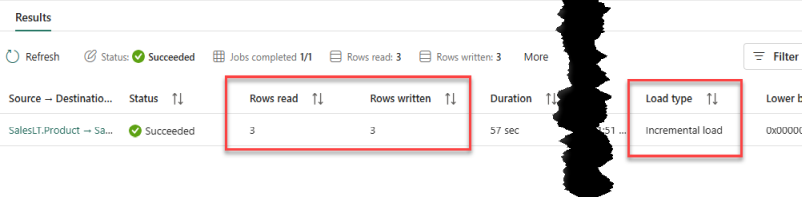

### 5.4. Modyfikacja wstawionych wierszy

Wykonaj:
- trzykrotną modyfikację produktu ZEROETL-CJ-SCD2_1
- jednokrotną modyfikację ZEROETL-CJ-SCD2_2
- skasuj produkt ZEROETL-CJ-SCD2_3

```sql
-- 100 -> 110
UPDATE SalesLT.Product
SET ListPrice = 110.00, ModifiedDate = GETUTCDATE() 
WHERE ProductNumber = N'ZEROETL-CJ-SCD2_1';

-- 110 -> 120
UPDATE SalesLT.Product
SET ListPrice = 120.00, ModifiedDate = GETUTCDATE() 
WHERE ProductNumber = N'ZEROETL-CJ-SCD2_1';

-- 120 -> 130
UPDATE SalesLT.Product
SET ListPrice = 130.00, ModifiedDate = GETUTCDATE() 
WHERE ProductNumber = N'ZEROETL-CJ-SCD2_1';

UPDATE SalesLT.Product
SET ListPrice = 299.00, ModifiedDate = GETUTCDATE() 
WHERE ProductNumber = N'ZEROETL-CJ-SCD2_2';

DELETE FROM SalesLT.Product
WHERE ProductNumber = N'ZEROETL-CJ-SCD2_3';
```

Uruchom **cj_zeroetl_cdc2**

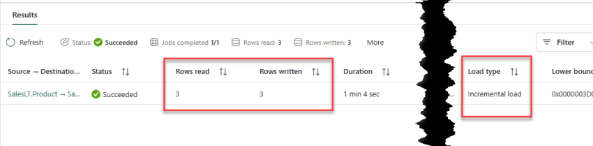

Sprawdź zawartość tabeli **SalesLT.Product_scd2**:
- pierwsza i ostatnia wersja produktu ZEROETL-CJ-SCD2_1
- poprzednia i aktualna (po zmianie) ZEROETL-CJ-SCD2_2
- produkt ZEROETL-CJ-SCD2_3 przed skasowaniem (is_current = false)

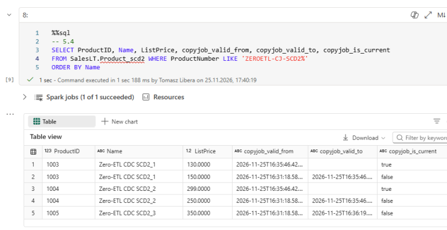


Wyświetl aktualną wersję tabeli **SalesLT.Product_scd2**:
- ostatnia (aktualna) wersja produktu ZEROETL-CJ-SCD2_1
- aktualna (po zmianie) ZEROETL-CJ-SCD2_2
- brak ZEROETL-CJ-SCD2_3
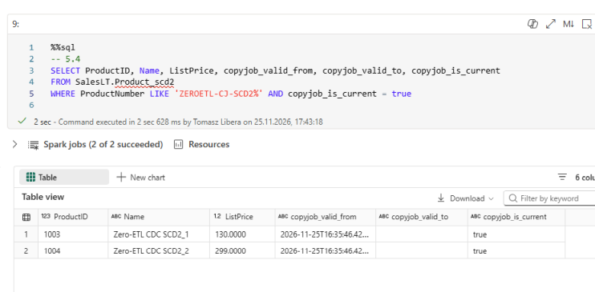


## 6. Cleanup

### 6.1. Azure SQL Database - baza źródłowa

```sql
-- Usunięcie zamówień demonstracyjnych
DELETE FROM SalesLT.SalesOrderHeader
WHERE PurchaseOrderNumber IN ('PO-ZEROETL-001', 'PO-ZEROETL-002', 'PO-ZEROETL-003');

-- Przywrócenie numeracji sekwencji
DECLARE @NextID varchar(10);
SELECT @NextID = ISNULL(MAX(SalesOrderID), 0) + 1 FROM SalesLT.SalesOrderHeader;
EXEC ('ALTER SEQUENCE SalesLT.SalesOrderNumber RESTART WITH ' + @NextID);

-- Usunięcie produktów demonstracyjnych
DELETE FROM SalesLT.Product WHERE ProductNumber LIKE 'ZEROETL-CJ-MERGE%'

DELETE FROM SalesLT.Product WHERE ProductNumber LIKE 'ZEROETL-CJ-SCD2%'

-- Przywrócenie numeracji IDENTITY
DECLARE @LastID int;
SELECT @LastID = MAX(ProductID) FROM SalesLT.Product;
DBCC CHECKIDENT ('SalesLT.Product', RESEED, @LastID);
```


### 6.2. CDC - opcjonalne wyłączenie

```sql
EXEC sys.sp_cdc_disable_table
    @source_schema = N'SalesLT',
    @source_name = N'Product',
    @capture_instance = N'SalesLT_Product';
```

### 6.3. Zasoby Fabric / Azure

- Usuń zadania `cj_zeroetl_watermark`, `cj_zeroetl_cdc`, `cj_zeroetl_cdc2` po zakończeniu demonstracji.
- Usuń **conn_zeroetl_azuresql_cdc**
- **sp-zeroetl-copyjob**, usuń w Azure SQL i App Registration / sekret w Key Vault po weryfikacji zależności.
- Zachowaj `AdventureWorks_CDC`, `lh_zeroetl_dest` i zasoby wspólne, będą używane w odcinku 28 (Pipelines).

## 7. Źródła

- [What is Copy Job in Fabric?](https://learn.microsoft.com/en-us/fabric/data-factory/what-is-copy-job)
- [Incremental copy in Copy Job](https://learn.microsoft.com/en-us/fabric/data-factory/incremental-copy-job)
- [CDC in Copy Job](https://learn.microsoft.com/en-us/fabric/data-factory/cdc-copy-job)
- [Azure SQL Database CDC and Copy Job - tutorial](https://learn.microsoft.com/en-us/fabric/data-factory/cdc-copy-job-azure-sql-database)
- [CDC with Azure SQL Database](https://learn.microsoft.com/en-us/azure/azure-sql/database/change-data-capture-overview?view=azuresql)
- [Copy Job connectors (aktualna macierz)](https://learn.microsoft.com/en-us/fabric/data-factory/copy-job-connectors)
- [Fabric September 2026 Feature Summary (CDC i SCD2 GA)](https://community.fabric.microsoft.com/blog/fbc_fabricupdatesblogs/fabric-september-2026-feature-summary/5325825)
- [Starszy materiał użytkownika: fabric17-copyjob](../fabric17-copyjob/)